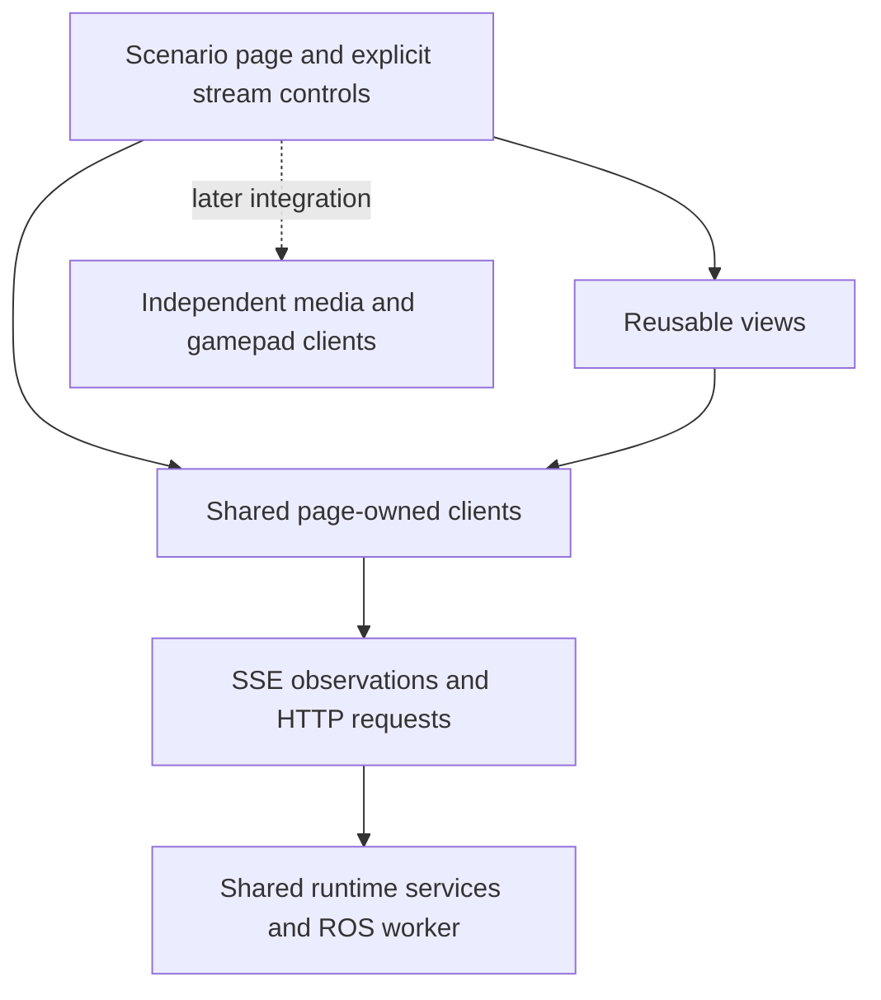

# Shared browser clients and channel contract

The packaged clients provide inert construction, shared observation ownership, explicit commands, and bounded delivery. [Multiplexed delivery](modular-runtime-delivery.md) is used by the reference page and minimal compositions; the v1 adapter remains available.

The primary use case is the runtime web interface without Foxglove. Foxglove
remains an optional unrestricted-inspection tool within its own existing
configuration. Detailed page design is separate work. The 256 KiB aggregate
observation-sample limit and all existing rate/freshness limits remain unchanged.

## Responsibilities and ownership



The robot owns authorization, command validation, run identity and shared ROS
demand. A browser client owns connection recovery and a bounded current read model.
The page owns client lifetimes, selected streams, visibility policy and layout.
Views subscribe to client state and invoke explicit operations; each view does not
open its own network stream. Clients contain no DOM queries, rendering, automatic
page-visibility listeners or robot-specific topic names.

Imports and constructors start no network requests or timers. `subscribe()` only
registers a listener. Acquiring a client does not connect until the page also
explicitly calls `connect()`. Multiple owners of one client share one connection.
The last release closes it and clears connection intent; reopening requires an
explicit `connect()`. Client disposal never stops a robot workload. Stream toggles
control delivery, independently of whether a panel happens to be visible.

Default page policy should release optional observations when a page is hidden
or navigated away from, remembering its selection for an explicit page-owned
resume policy. The shared client does not silently make that decision. Live
driving focus/authority policy is separate from ordinary observation visibility.

## Channels and delivery semantics

| Logical data | Current access | Required semantics |
| --- | --- | --- |
| Unit lifecycle/ownership | `runtime` stream | Complete current state, manager/boot/config identities, age and expiry. |
| Traxxas/policy application state | Selected IDs on `observations` | Independent from process lifecycle; latest state is not a lossless transition log or request acknowledgement. |
| Individual sensors and vehicle signals | Selected IDs on `observations` | Sequence, run/stream identity, receipt/acquisition ages, frames, units, valid empty data and explicit staleness. Per-topic caps remain server-owned. |
| Diagnostics | Selected IDs on `observations` | A convenient selection group; freshness and interpretation remain per observation. |
| Parameter values/descriptors | Explicit HTTP reads and edits | No background polling. Preserve typed values, atomic edits, acknowledgement/readback distinction and startup-only restrictions. |
| Capability catalog | Explicit HTTP `api/ros` | Separate from observation-client state and sample delivery. |
| Resources | `resources` stream; explicit HTTP history read | Optional shared 1 Hz collector, bounded history, expiry and last-consumer release. |
| Commands and action outcomes | Explicit HTTP operations | Correlated requests and outcome lookup; no automatic replay. Feedback and observed state do not prove command completion. |
| Logs and snapshots | Explicit HTTP requests | Respect existing bounds and gap/image freshness fields; no automatic follow or capture. |
| Video and gamepad input | Later integration | Separate clients, sessions and transport lifetimes; no implicit dependency on an observation stream. |

This grouping does not require a separate network connection per topic. The
original `SseTransport` uses one connection per logical channel. The integrated
`MultiplexSseTransport` shares one physical connection across a page's acquired
channels. One observations client carries its selected topic union. Sharing
across separate pages happens on the backend; it does not remove each page's
transmission cost. See [multiplexed delivery](modular-runtime-delivery.md) for the three-tab regression and HTTP/1.1 limits.

## Implemented module API

All modules are plain JavaScript ES modules, with no frontend framework, external
runtime dependency or build step. They are served under `/assets/`.

### `StreamClient`

`client-stream.mjs` exports `StreamClient({channel, transport, ...testHooks})`.
`channel` is `runtime`, `observations`, or `resources`. The page normally creates
at most one client for each channel it uses, and shares it among views.

| Member | Contract |
| --- | --- |
| `state` | Current `{connection, wanted, topics, snapshot, error}`. Treat snapshots/data as read-only. Ages and freshness are evaluated at the time of the read. |
| `subscribe(listener, {topics})` | Immediately provides state, then changes; returns an idempotent unsubscribe function. An optional observation-topic filter limits update notifications. Does not acquire or connect. |
| `acquire()` | Returns an idempotent release function. Active owners share the connection. Last release clears connection intent and closes owned work. |
| `connect({topics})` | Explicit connection intent. Observations require a nonempty list of capability IDs; other channels take none. IDs are deduplicated/sorted. Changing selection replaces the stream and clears the old baseline. |
| `disconnect()` | Closes the connection and expiry timer. Retained samples are immediately non-fresh. Does not issue robot commands. |
| `dispose()` | Idempotently closes work and clears listeners. Later acquire/connect/subscribe calls fail. |

`connection` is `idle`, `connecting`, `open`, `disconnected`, or `disposed`.
`open` describes the transport only: `snapshot` can still be absent or stale.
Runtime observations expire after the existing 15 s threshold. Resource samples
use `stale_after_seconds`. Topic freshness combines receipt and declared
acquisition/sample ages, preserving the IMU's strict sample-age boundary.
String-encoded int64 and epoch-nanosecond values remain strings.

A single timer notifies listeners at the next freshness deadline. There is no
client animation/polling loop. Reading state computes expiry even if the browser
delays that timer. A heartbeat or connection-open event does not renew samples.
An interrupted connection invalidates freshness until a new baseline arrives.
Callbacks from replaced/disposed connections are ignored. Complete snapshots
replace previous collections, so missing or empty observations do not leave old
data presented as current.

The client reports source freshness, not command authority. Pages still combine
runtime lifecycle, ownership, application state and target/run evidence where
needed. The server revalidates every command; a fresh browser view is never an
authorization mechanism.

### Transport port and `SseTransport`

`client-sse.mjs` exports `SseTransport({base, ...testHooks})`. It implements:

```js
const close = transport.open({channel, topics}, event => { /* client callback */ });
```

`close()` is idempotent. Events are:

- `{type: 'connected'}`: connection open; no sample-freshness implication.
- `{type: 'snapshot', snapshot}`: complete current read model for the selection,
  with original source identities and ages preserved.
- `{type: 'disconnected', error}`: observation delivery unavailable; old positive
  freshness must be invalidated immediately.

The port's snapshot is a local read model, not a requirement to send a complete
network snapshot for every update. The multiplex adapter assembles this model from
versioned per-topic updates. It must replace the baseline on reconnect and remove
missing/unavailable items; it must not retain a previous run's sample as current.
The [delivery contract](modular-runtime-delivery.md) specifies the version 2 wire format and selective notifications
while retaining this complete local read model.

The original `SseTransport` maps to `api/events`, `api/ros/events?topic=...`, and
`api/resources/events`. Native EventSource reconnects interrupted streams; the
adapter retries permanently closed/admission-failed sources at 1 s intervals.
Closing cancels retries. A future WebSocket adapter must satisfy the same lifecycle
and freshness tests. Only one adapter runs for a particular client. HTTP commands
can remain shared even during a future dual-transport comparison.

### `HttpClient`

`client-http.mjs` exports `HttpClient({base, headers, fetcher})`, with
`get(path, options)`, `post(path, body, options)`, `operation(requestId, options)`
and `dispose()`. All operations are explicit. There is no automatic login,
catalog refresh, parameter polling, command replay or operation polling.

The page supplies the current CSRF header through `headers()`. Authentication
cookies are managed by the browser/server; credentials use `same-origin`.
Current production hosting remains same-origin. A configurable mount prefix is
preserved, but it does not add server CORS or cross-origin command support.
Paths are relative to the API base and cannot escape its origin/mount prefix.

Each request has a timeout (default 5 s) and optional AbortSignal. Disposal aborts
pending requests. Image captures may need a longer explicit timeout because their
server deadline is 8 s. Aborting a request does not undo a command already sent.
Pages supply the existing typed command body: request ID, target/config/run
identity and deadline as required by its endpoint. This helper does not invent
fresh command authority from cached data.

`RequestError` preserves `code`, HTTP `status`, `requestId` and `outcomeUnknown`.
Transport loss after a POST, a server failure, or an explicit unknown-outcome
response is potentially uncertain. The caller keeps its request ID and looks up
the operation instead of automatically sending it again. A successful HTTP reply
retains the server's acceptance/outcome semantics; the client does not reinterpret
it as physical success. Page-level pending-operation persistence and typed command
views retain their existing behavior in the integrated reference UI.

## Page composition example

This is an integration example, not a new production UI:

```js
import {HttpClient} from '/assets/client-http.mjs';
import {SseTransport} from '/assets/client-sse.mjs';
import {StreamClient} from '/assets/client-stream.mjs';

const http = new HttpClient({base: '/', headers: () => ({'X-CSRF-Token': currentCsrf})});
const transport = new SseTransport({base: '/'});
const runtime = new StreamClient({channel: 'runtime', transport});
const observations = new StreamClient({channel: 'observations', transport});
const releaseRuntime = runtime.acquire();
const releaseObservations = observations.acquire();
const unwatchRuntime = runtime.subscribe(state => statusView.update(state));
const unwatchObservations = observations.subscribe(state => spatialView.update(state));
runtime.connect();
// Page-owned toggle; IDs come from the robot's capability catalog.
observations.connect({topics: selectedObservationIds});

// Page teardown; removing one view need not dispose clients shared by other views.
unwatchRuntime(); unwatchObservations();
releaseRuntime(); releaseObservations();
runtime.dispose(); observations.dispose(); http.dispose();
```

Parameter panels can use `http.get('api/ros/parameters/' + encodeURIComponent(id))`
on explicit refresh. Mountable views should accept `(root, dependencies)`, own
only that root and their listeners, and return `{destroy()}`. Creating a second
view should reuse the page's clients. An autonomous page needs status and selected
application-state observations; an outreach page adds selected sensor IDs.

## Camera/gamepad integration boundary

Media and gamepad clients use state/subscribe/acquire/release/dispose conventions and mountable views. Their backends enforce runtime authentication, camera admission, and workload lifecycle. Video, input acquisition, input transport, and vehicle actuation have separate responsibilities. Diagnostic input receipt does not grant exclusive vehicle authority. Camera changes cannot implicitly recreate control sessions; loading an observer page cannot start gamepad sampling. See the [media contract](camera-gamepad-integration.md).

## Verification

The browser-client suite uses injected clocks/transports for lifecycle and expiry edge cases, then real Chromium EventSource/fetch against a private loopback fixture. It exercises the packaged modules without accessing hardware. Web tests check asset allowlists and MIME types. Follow the [verification instructions](../tests/README.md#shared-browser-client-foundation); fixture results do not establish loaded or hardware performance.
