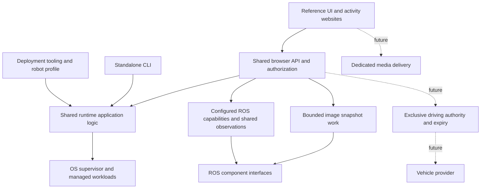

# robot_runtime integration contract

This document defines responsibilities and required semantics for the [repository charter](repository-charter.md). Concrete implemented configuration and commands are described in the operator guides. Numerical targets follow the charter's early-discussion policy.

## Platform boundary

These boxes describe logical responsibilities, not a mandatory process topology. Expensive work must be isolated sufficiently to preserve command responsiveness and future driving expiry. The CLI must remain usable without the web server. Sites share coordination and observations; each does not create its own robot backend.

## Deployment and configuration

`robot_runtime` owns its supported installation interface, configuration schema, service definitions, diagnostics, and uninstall/upgrade behavior. An installation must be usable independently on a prepared ROS 2 host. Installed code and browser assets must not depend on a particular source checkout or an Internet service during operation.

The deployment integrator supplies the selected release and a validated robot profile. In the [research architecture](research-platform-architecture.md), `robot_composition` selects the system and `robot_installer` provisions it. The profile supplies:

- The robot identity, runtime account, runtime namespace, and state/log/config locations.
- Available runtime units and their launch composition: executable/launch references, resolved environment, arguments, dependencies where applicable, and graceful-stop expectations.
- Each unit's declared ROS nodes, topics, services/actions, namespaces, types, permitted operations, health/readiness sources and expiry policies.
- Parameter exposure and edit permissions, image sources, resource/rate limits, and the public data surface.
- Browser hosting/origin policy and references to separately managed credentials or pairing state.

Validation must report unsupported versions, malformed profiles, missing dependencies and incompatible capabilities before activation. A browser chooses a declared capability and arguments; it cannot submit arbitrary shell commands, executable paths, ROS targets, or unvalidated configuration. Robot-specific names and behavior belong in the profile or provider adapters, not frontend conditionals.

Package version, public API version, profile schema version and persistent-state version are distinct. Compatibility rules and migrations must be explicit. Release metadata must declare the tested OS/architecture/ROS/browser matrix and dependency requirements. Ubuntu/Jetson is the initial target; additional platforms need evidence before support is claimed.

Management startup validates configuration and state compatibility without launching application workloads. Updates and incompatible migrations require an explicit maintenance window with workloads stopped; recovering management after a crash must not migrate live workload state implicitly. Configuration persistence is separate from live ROS parameter editing.

## Runtime lifecycle and authority

The supervisor is authoritative for actual process/unit state. `robot_runtime` owns declared configuration, stable unit identifiers, run identities, operation records and history. Observation caches summarize evidence and have no independent authority to start, stop, or claim ownership of a process.

The systemd/cgroup candidate must meet the following contract before selection:

- Management services start at boot, while application workloads require explicit starts and do not automatically restart after failure.
- Workloads survive a management/web restart. Recovery reconciles actual units with durable run metadata, without recreating a launch merely because an old request is incomplete.
- Ownership is bounded to this runtime's declared units and run identities. Conflicting, unrelated, or ambiguous processes are surfaced, not adopted or killed based on a name match.
- Normal stop follows the declared graceful sequence for the workload and its descendants. A timeout reports remaining work. Default supervisor force-kill behavior must not silently override this contract; any future forced termination is a distinct authorized operation.
- Process exit, descendant lifetime and partial shutdown remain observable. Reusing a PID or unit name must not make an old request target a new run.

Choose user-manager versus system-service deployment, boot persistence, privilege scope, durable run metadata, and exact graceful signal/timeout behavior in the supervision design. A workload's own behavior remains the provider's responsibility; systemd configuration alone does not establish application readiness or physical stopping.

## Observations and subscriptions

Every observable capability must distinguish what is known from what is inferred. Runtime lifecycle, process ownership, provider readiness, progress/health, ROS application state, and freshness are separate fields or records. A running process does not imply that a sensor is producing valid data, a vehicle is enabled, or an operation succeeded.

Latest-state subscriptions must provide a complete initial state, an instance/stream generation, revisions or sequence numbers, timestamps with declared clock domains, and explicit expiry/unavailable states. Reconnection establishes a new baseline. It must not reset the acquisition age of cached data or retain positive health after its evidence expires. Robot reboot invalidates prior monotonic-clock comparisons.

Replaceable observations may coalesce intermediate updates. Slow viewers receive recent state within bounded queues and cannot block other viewers. These streams are not lossless event histories. Operation records and logs have separate delivery/retention semantics: expose operation status lookup, and make log truncation or gaps visible.

A fresh-status operation bypasses observation caches and audits current supervisor state. It does not implicitly establish application readiness or refresh unrelated ROS evidence. Read results identify their source and freshness. Failed or stale observations must be explicit, including when the monitor or ROS integration is unavailable.

## Browser commands and authorization

The local network may view the full website and the configured exposed data without pairing. Every command requires robot-enforced authentication through the shared robot credential or pairing mechanism. Authenticated browser sessions remain distinct for operation attribution and future driving ownership; their labels do not establish individual human identity.

Authentication and authorization are shared across websites and checked on every protected operation. A local ROS bridge transport must not expose an alternative unauthenticated command route. Define supported website origins, secure local transport/session handling, expiry/revocation, and offline pairing before releasing command access. An origin check or anonymous cookie alone does not authenticate a controller.

Commands carry a correlation identifier, target capability, expected run/generation when applicable, typed arguments, and a bounded lifetime. The backend coordinates conflicting operations across clients. It rejects stale targets and describes busy/timeout/unavailable outcomes instead of silently accumulating unbounded work.

Delivery, acceptance and completion are distinct. A topic publication can establish that a request was sent; it cannot establish provider acceptance. A later matching state is an observation, not proof that a particular request caused it. Use request-specific acknowledgement/results when the provider supplies them, and report uncertainty otherwise.

A disconnected client must not replay a command automatically. Define deduplication scope and retention, including management restart behavior; do not promise exactly-once execution. A client should reconcile an uncertain operation through its identifier and current state. A transient failure may leave an outcome unknown.

Builds, firmware flashing, machine installation and calibration workflows from the exploratory UI are outside this first runtime/browser command surface. Their ownership and permissions require a separate integration decision if added later.

## ROS providers and live parameters

The bridge exposes configured capabilities rather than an unrestricted browser ROS client. A runtime unit may map to several ROS nodes; its unit ID is not a node name. The profile or provider adapter declares exact node/topic/service/action mappings, message types, QoS needs, namespaces, permitted fields/operations and lifecycle constraints. Capability discovery lets websites render available functions without hardcoded robot names.

Run-bound commands must validate the current run and target mapping. Duplicate or ambiguous graph identities must fail clearly. ROS graph names and telemetry alone do not authenticate an operating-system process or prove that a publisher belongs to the current run. State that evidence limit; any stronger identity requirement needs provider support.

Parameter access preserves ROS types, descriptors, read-only status, range hints and provider rejection reasons. Encode int64 values and timestamp integers losslessly for browser clients. Parameter metadata is guidance; the provider's validation callback remains authoritative.

Where supported, related edits use the provider's atomic per-node operation. Acceptance, readback success and the observed resulting values are distinct. A different writer may change a value before readback; the API must not imply compare-and-set protection that the provider does not offer. Define concurrent-edit handling and parameter-level permissions explicitly.

Live parameter edits affect the current node instance only. Saving startup configuration is a separate, explicit workflow. A startup-only parameter must not be presented as live-editable merely because a generic ROS service exists. Opening or refreshing an Info panel may inspect permitted parameters without starting the node.

ROS dependency setup must use declared installation interfaces rather than another repository's private helpers. Preserve a clear boundary between the runtime/web environment and ROS-native dependencies; the exact process and packaging arrangement remains a design choice.

## Telemetry and visualization

Share upstream subscriptions and compatible conversion/serialization across websites. Each client requests permitted streams at bounded rates; the server enforces ceilings and admits work against shared resource limits. Per-client transmission still incurs cost. Disconnecting, hiding or pausing a view should release unnecessary delivery and processing according to a declared policy.

Visualizations should normally render on the client from compact observations. A runtime-only page must not initialize image processing, subscribe to camera images, or start an encoder. Demand-based bridge cleanup does not stop an explicitly started detector or change its processing rate without a separate authorized operation.

Each spatial stream declares coordinate frame, units, axis convention, acquisition timestamp and clock domain, bridge receipt time, source/stream generation, and sequence. Transform explicitly or reject unsupported frames. Preserve the distinction between detector output and an observation actually consumed by a policy. Do not encode epoch nanoseconds as an imprecise JavaScript number.

A fresh empty batch replaces prior detections; it is distinct from stale data, disconnection, or an unavailable source. Freshness thresholds and fade behavior are capability/presentation policies. Do not imply persistent object identity where the provider supplies no stable IDs.

The first-release sizing target is up to 20 cones per displayed batch. Define behavior for larger batches before release: reject an unsupported profile, or apply a declared selection/limit and report original count and truncation. A partial batch must never appear complete. The exploratory 50-detection envelope is useful input to this policy, not a change to the agreed sizing target.

## Image snapshots and future media

A snapshot reads a permitted existing ROS image source and returns bounded image data with source identity, dimensions, format, acquisition time and freshness. Set limits for output dimensions/bytes, conversion concurrency, request rate, maximum acceptable source age, cancellation and failure cleanup. A request for an image is not evidence of a newly acquired frame.

A public viewer may request a permitted read-only snapshot and bounded conversion. The request must not implicitly launch a camera workload, change camera settings, or open a device independently of its owner. If a provider requires such an operation, expose the requirement and use the authenticated command path separately. Avoid large image payloads on the latency-sensitive status/control stream.

For later live media, identify capture ownership, capture configuration, encode profile and consumer session separately. Share capture and compatible encodes where supported; admit incompatible profiles explicitly rather than silently reconfigure another viewer's stream. Discover transports, codecs, playback policy, session limits and receiver prerequisites. Native receiver installation and separate-window presentation must be visible capabilities.

Define media startup/readiness, subscription expiry, last-consumer cleanup, configuration restoration and crash recovery. Separate delivery/progress from slow statistics collection. Track frame progress and staleness independently of connection state, with unavailable values where source age cannot be established. The five-browser target does not guarantee five media sessions. Whether a future public subscription may activate predefined media work remains a media-design decision under the command policy.

## Future manual driving

Reserve one shared robot-side authority mechanism across all websites: explicit authenticated claim, an exclusive lease, explicit arm, fresh sequence-bound commands, release, expiry and revocation. A valid lease prevents another browser taking control. Reconnection never resumes a previous driving session automatically.

The robot enforces command freshness independently of browser timers and image/video processing. Expiry requests the provider's defined stop behavior and clears authority; accepting a network command is not proof of physical response. The vehicle contract must specify stop semantics, readiness, maximum command age, watchdog placement and observed behavior under failure before driving is released.

An ordinary workload surviving management failure must not retain indefinite driving authority. Video freshness and driver-command freshness are separate signals; a future driving design must explicitly determine the response to stale visual feedback.

## Evidence and acceptance

All execution tests run on `jah` with isolated names, files, ports, ROS domains and services where appropriate. Preserve the existing deployment. Use fixtures before provider/hardware integration, and identify the limits of every result.

Before first stable release, demonstrate lifecycle/descendant cleanup, graceful-stop timeout handling, management recovery, no implicit workload startup, authorization enforcement across supported websites, stale-target rejection, bounded slow-client behavior, reconnect/reboot freshness, provider acceptance/rejection, snapshot limits, offline cold start and documented recovery. Measure the charter's sizing and resource objectives, including return to baseline when optional consumers leave.

Any future deployment migration should pin a supported release, supply a profile and use supported APIs/CLI/install interfaces. Legacy saved-run formats are not automatically accepted; archive or migrate them explicitly with workloads stopped. Define rollback of package and compatible state/config together before replacing the old deployment.
