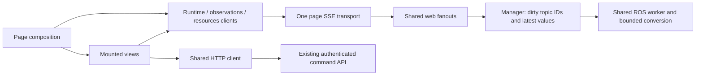

# Modular clients and efficient SSE delivery

The [browser-client contract](browser-client-contract.md) is implemented by shared clients, one multiplexed SSE transport per page, and bounded manager observations.

## Design

The reference page and the two minimal compositions use `createPageClients()`.
It creates inert runtime, observations and resources clients, a shared HTTP
client, and one `MultiplexSseTransport`. Views subscribe to state and invoke
explicit operations. Pages choose acquisition, connection, topic selection,
visibility and teardown. No view starts a workload, opens a socket, or infers
command success from telemetry.



`/autonomous` mounts runtime state and four application-state capabilities
(policy state code/text and Traxxas state code/text). `/outreach` mounts those
same views plus the profile's remaining sensor/diagnostic capabilities. These
are small reuse examples whose application-state IDs must be declared in the profile, not a finished scenario UI. Both require an explicit
Observe action and release optional observations while hidden. The reference
page retains its spatial, parameter, action, snapshot and command workflows.
Its HTTP helper now delegates to `HttpClient`; pending operation IDs and
explicit outcome reconciliation retain their existing behavior.

The shared clients and views contain no robot topic names. The four IDs above
belong to the example page's selection policy. Missing capabilities produce an
empty view. Importing or constructing a client starts no network request.
Page navigation releases delivery; it does not stop robot workloads.

## Delivery protocol

The new endpoint is
`GET /api/stream?channel=runtime&channel=observations&topic=ID&channel=resources`.
Channels may be selected independently; observations require configured topic
IDs. Query fields, channel names and admission bounds are validated before the
response starts. Commands remain explicit HTTP requests through the existing
authorization/CSRF and run/configuration validation.

Every data event has `version: 2`, a connection-specific `stream_id` and a
strictly increasing `sequence` starting at one. It contains only changed logical
channels. Runtime and resource values are complete current read models at their
own update rates. Resource history is included on connection or history reset.
Observation values have this shape:

```json
{
  "reset": false,
  "header": {"api_version": 1, "available": true, "generation": "worker"},
  "metadata": [],
  "sent_at": 123.5,
  "updates": [
    {"at": 123.49, "value": {
      "id": "capability-id",
      "run_id": "run",
      "stream_generation": "topic-stream",
      "sequence": 42,
      "status": "current",
      "fresh": true,
      "age_seconds": 0.01,
      "data": {"data": "9223372036854775807"}
    }}
  ]
}
```

This is an abbreviated example, not a complete schema. Each topic's metadata
includes its configured identity, type, fields, projection, units/frame
conventions where applicable, rate ceiling and freshness threshold. It is sent
on the baseline or when it changes. Services, commands, parameter descriptors,
action capabilities and snapshot catalogs are obtained through explicit HTTP
reads rather than repeated in every observation sample.

The manager accumulates changed topic IDs in a bounded set and queues a wakeup,
not a series of full snapshots. The private web watch drains that set into
independent latest values. It also separates metadata. The web fanout serializes
each changed sample once and reuses that representation across viewers. Each
viewer has a small cursor so skipping a wakeup does not drop a different topic's
latest value. No transition log or lossless delivery promise is introduced.

`at` and `sent_at` are readings of the same host monotonic clock. They account
for time retained in the web cache without assuming clock synchronization with
the browser. The adapter adds that interval to relative sample ages and then
ages each topic independently on the browser's monotonic clock. An update to
one topic, a heartbeat, or a connection-open event cannot refresh another topic.
Nanosecond and int64 strings remain strings. Empty data replaces the previous
value. Run/source changes, unavailable sources and absent baseline topics do
not retain old data as current.

Each reconnection starts a complete baseline; there is no `Last-Event-ID`
replay or command replay. A stream-ID change, sequence gap or malformed update
invalidates freshness and causes a bounded read-only reconnect. The local
`StreamClient` read-model API remains version 1, independent of the version 2
wire envelope. `subscribe(listener, {topics: [...]})` optionally limits
observation notifications; expiry and connection changes still notify views.

The original SSE endpoints and `SseTransport` remain available for direct
logical-channel consumers. The reference and example pages use the new shared
transport. Capability catalogs are read through `/api/ros`.

## Connection contention and bounds

The baseline used two persistent HTTP/1.1 connections per active page. Three
tabs occupied six connections and periodic action reads stalled. Combining
runtime, observations and optional resources uses one persistent connection per
page, leaving capacity for HTTP reads and commands in the measured three-tab
case. A selection change closes the previous connection before replacing it.

This does not promise unlimited tabs. The browser's connection pool remains
finite; six or more simultaneously observing pages can still exhaust a common
HTTP/1.1 pool. Cross-tab shared workers and HTTP/2 are separate possible
extensions. Existing server admission ceilings remain eight page streams and
eight consumers per logical fanout, not an expanded capacity claim.

The 256 KiB aggregate observation-sample budget, 512 KiB IPC ceiling, per-topic
rate caps, ROS QoS, freshness thresholds and resource collector's 1 Hz rate are
unchanged. Each page has one latest-state wakeup queue; each topic has one cached
value. Writes have a two-second deadline; silent streams send a five-second
comment heartbeat. Closing a page releases its selected demand, and the last
consumer releases upstream observations/collection. The worker's existing
bounded conversion and image paths remain separate.

## Verification

Use the [client and native browser suites](../tests/README.md). Tests cover shared delivery, invalidation, reconnection, command access, and release after the final consumer. Loaded performance and hardware acceptance require separate measured evidence.
