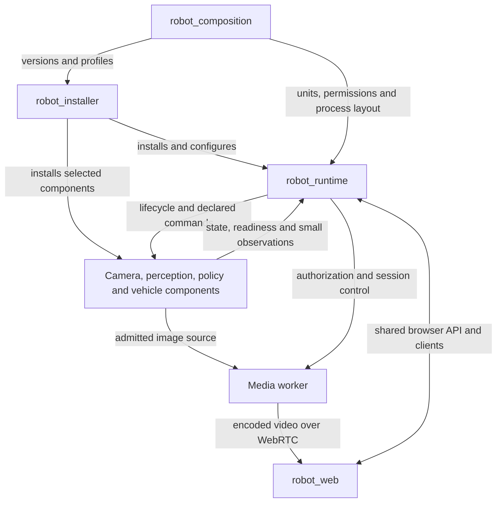
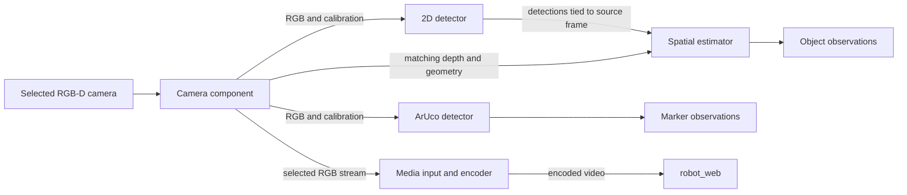

# Research robot platform architecture

This document records the agreed repository boundaries and proposed camera/perception contracts. Components and interfaces described as proposed are not claims about the current implementation.

The six accepted repository names are `robot_runtime`, `robot_composition`,
`robot_installer`, `rgbd_camera`, `rgbd_object_detector` and `robot_web`.
`rgbd_camera` is a separate repository for acquisition shared by perception and
video. OAK-D is the first camera target; RealSense may be introduced during that
development or afterwards to exercise the same interfaces. The process layout
below is the recommended initial implementation, subject to measurement.

The [charter](repository-charter.md) and [integration contract](integration-contract.md) define the runtime's lifecycle, authorization, and freshness requirements.

## Repository responsibilities

| Repository | Owns | Interfaces with |
| --- | --- | --- |
| `robot_runtime` | Process supervision, command policy, observations, CLI, authenticated browser API, reusable browser clients, reference UI, media session coordination and future driving authority | Robot profiles, component readiness/commands, OS supervisor and media workers |
| `robot_composition` | Reproducible system selections, exact component/model versions, named robot/scenario profiles, launch topology, configuration, mounting transforms and integration acceptance | Installer input and runtime/component configuration |
| `robot_installer` | Host preparation, dependency/toolchain installation, fetching/building selected sources, invoking component installers, upgrades and recovery | Versioned composition manifests and component installation interfaces |
| `rgbd_camera` | Camera discovery/selection, exclusive device session, capture/depth configuration, calibration, synchronization, frame delivery and reusable provider adapters | ROS image interfaces and an internal frame/provider API |
| `rgbd_object_detector` | Model descriptors, inference adapters, 2D detection, depth association, spatial estimates and the first cone model/profile | Camera contract in; detections and processing status out |
| `robot_web` | Autonomous, outreach and FPV experiences, page composition and presentation | Versioned runtime browser clients/API and admitted media sessions |
| Other component repositories | ArUco, vehicle interfaces, policy, other sensors and firmware; their algorithms, configuration validation and readiness | Their documented ROS and hardware interfaces |

`robot_composition` chooses what is installed and how it runs. `robot_installer`
executes that selection; it does not quietly resolve a different set of versions.
Each component retains a standalone installation interface and declares its own
dependencies. The installer coordinates those interfaces rather than accumulating
copies of component build logic. Local credentials and per-device secrets stay
outside published profiles; profiles reference separately managed values.

Camera acquisition has consumers even when object detection is disabled. Giving
it an independently usable package avoids requiring detector models or inference
dependencies for ArUco and video. The separate `rgbd_camera` repository owns that
responsibility and can contain several provider and interface packages. Existing
vendor drivers/SDKs should be adapted where suitable; this is
not a proposal to reimplement camera firmware or every vendor driver.

Shared interface packages stay with their owning capability, independently
installable from implementation packages. Use standard ROS types where their
semantics fit. Introduce custom messages only for concrete gaps, with explicit
versions; avoid a general collection of unrelated robot messages.

## System boundaries

These boxes describe responsibilities; the process layouts below determine which
components share an address space.

The runtime remains independently usable through its CLI. Browser pages share its
authorization and command rules. `robot_web` does not create another ROS bridge,
camera owner or driving-authority service. The runtime can host a separately
versioned bundle of website assets; a separate repository need not add a server.

Media processing stays outside the manager and HTTP command loop. Raw continuous
camera images do not flow through the general telemetry/SSE path. Small detection
results can use that path; video uses an admitted encoder and dedicated transport.
Generic media workers and their ROS/native-buffer adapters belong to optional
`robot_runtime` integration packages. Vendor capture/session code belongs to
`rgbd_camera`; camera SDKs and encoders stay out of the runtime core's dependencies.

The browser starts workloads only through explicit commands. Consumer demand may
activate configured optional output branches within an already started provider.
Closing the last viewer releases media resources without stopping perception that
another active workload needs. The composition defines camera dependencies and
conflicts, including standalone video operation without an object detector.

## Camera and processing components

The normal host-processing layout separates acquisition from its consumers:

Implement performance-sensitive host components in C++ with `rclcpp_components`,
supporting both composition and standalone execution. Keep reusable processing
logic behind thin ROS adapters. This proposal concerns the image path; it does not
require rewriting the Python runtime or all existing components in C++.

Process layout belongs to `robot_composition`. ROS 2 supports choosing between
separate processes and components in a shared process at deployment time.
[ROS 2 Jazzy composition documentation](https://github.com/ros2/ros2_documentation/blob/jazzy/source/Concepts/Intermediate/About-Composition.rst).

| Layout | Intended use | Trade-off |
| --- | --- | --- |
| Camera, detector, spatial estimator and ArUco in one perception container | Initial candidate for efficient host processing | In-process frame exchange; components share the process failure boundary |
| Components in separate processes | Debugging, independent recovery, or providers that cannot be composed | Better fault isolation; image transport/copy costs require measurement |
| OAK device pipeline with one host owner | OAK capture, depth and on-device inference | Efficient device execution; pipeline changes may require a coordinated restart |

Start with the available OAK-D and cone model, using GPU/TensorRT inference to
exercise the independent camera, inference and spatial interfaces. Compose those
C++ components with ArUco in one perception container, with intra-process delivery
enabled and bounded queues. Then add the OAK on-device inference provider against
the same public contracts. These are implementation recommendations; OAK-D as the
first camera is the agreed hardware direction.

Initially keep media input/encoding in a separate worker consuming a bounded,
explicitly enabled ROS RGB branch. This provides a simple isolation boundary and
reuses the current media integration approach; it may copy frames. Measure that
cost before deciding whether a native-buffer adapter or encoder composition is
worthwhile. Browser signalling, runtime management and vehicle stop/watchdog
execution remain separate from the image-processing container.

Within a container, bounded work queues and deliberate callback/executor scheduling
keep slow inference or encoding from starving capture. A multithreaded executor
alone does not guarantee that isolation or a latency bound.

The runtime supervises a container as one process unit and reports the readiness
of its constituent components. A container crash affects all its components.
Independent component enable/disable is available only where lifecycle behaviour
is implemented and verified. Loading components or using separate executors does
not establish process fault isolation. Recovery follows the runtime's explicit
restart policy.

## In-process buffers and shared memory

Composition makes efficient communication possible; composition alone does not
enable or prove zero-copy. Enable `use_intra_process_comms` for compatible endpoints
and choose message ownership deliberately. ROS demonstrates zero-copy transfers
for an appropriate unique-pointer pipeline; additional consumers and external
subscribers change the transfer requirements.
[ROS 2 Jazzy intra-process demonstration](https://github.com/ros2/ros2_documentation/blob/jazzy/source/Tutorials/Demos/Intra-Process-Communication.rst).

For fan-out, prefer immutable frame buffers that consumers can retain safely.
Consumers performing annotations or other modifications allocate their own output
or acquire exclusive ownership. Buffer lifetimes must cover asynchronous inference
and encoding; an SDK must not reuse storage while a consumer still reads it.

Three mechanisms need separate treatment:

- **One process:** components exchange references or transfer ownership through
  intra-process communication. They already share an address space.
- **Separate processes:** middleware shared-memory transport and loaned messages
  depend on the selected RMW, message types and configuration. A shared-memory
  transport does not by itself establish end-to-end zero-copy. Standard image
  messages have dynamically sized data; loaning must be verified for the actual
  image path. [ROS 2 Jazzy loaned-message guidance](https://github.com/ros2/ros2_documentation/blob/jazzy/source/How-To-Guides/Configure-ZeroCopy-loaned-messages.rst).
- **Camera, GPU and encoder:** SDK buffers, pixel conversion, tensor preparation,
  GPU transfers and encoder input can introduce copies or synchronization costs
  independently of ROS. Native buffer interoperability is an optional optimized
  path with explicit ownership and completion semantics.

Use standard ROS image messages as the interoperability baseline. Add internal
buffer adapters only when measurements justify them, keeping a usable standard
message path for external tools and recording. The target is bounded latency and
resource use with clear ownership. Any zero-copy claim must identify the exact
boundaries measured, including the effect of an external image subscriber.

## Camera interface

The camera provider owns one physical device session and exposes a stable source
identity independently of the selected inference backend. Discovery reports
capabilities without starting capture. Configuration may select a serial/device
identity or a documented automatic preference policy. Ambiguous selection and
unsupported modes produce explicit errors. The resolved device, mode and backend
are reported; switching device or computation backend requires an explicit
reconfiguration.

| Interface | Required information or behaviour |
| --- | --- |
| Capabilities | Device identity, supported RGB/depth modes, calibration availability, synchronization options and supported device processing/encoding features |
| Configuration | Stream sizes/rates/formats, exposure/depth settings, enabled outputs and allowed changes during a run |
| Frames | RGB and/or depth, acquisition timestamps, declared clock domain/mapping, source generation, capture identity and pairing information |
| Geometry | Optical frame, intrinsics/distortion or rectified projection, depth units/convention, RGB/depth extrinsics and calibration identity |
| State | Configured/streaming/unavailable/error, current generation, observed rates, last acquisition, drops and synchronization failures |
| Ownership | One device session; explicit start/stop/reconfiguration and release of buffers, handles and output branches |

The ROS baseline is `sensor_msgs/Image` with matching `sensor_msgs/CameraInfo`.
Image timestamps represent acquisition and `header.frame_id` names the optical
coordinate frame. It is not a per-capture sequence identifier. Additional metadata
needs an explicit binding to the images; exact message schemas are a subsequent
interface-design step.
[Image definition](https://github.com/ros2/common_interfaces/blob/jazzy/sensor_msgs/msg/Image.msg),
[CameraInfo definition](https://github.com/ros2/common_interfaces/blob/jazzy/sensor_msgs/msg/CameraInfo.msg).

Choosing the exact schema means agreeing field names and representations so that
both ends interpret data identically: which image a detection belongs to, when it
was captured, which coordinate frame it uses, the depth units and how unavailable
depth is represented. Standard ROS messages supply much of this. The remaining
metadata will be specified during component design, using the requirements here;
it does not need to block the repository naming and hosting transition.

RGB and depth need not have identical resolutions. A provider declares whether
depth is aligned to RGB or supplies the calibrated mapping. Cropping, resizing and
rectification update the applicable geometry. Depth encoding specifies units,
invalid values, and whether values represent optical-axis depth or range.
Mapping between colour and depth must account for their viewpoints and occlusions.
[RealSense projection and alignment reference](https://dev.realsenseai.com/docs/projection-texture-mapping-and-occlusion-with-intel-realsense-depth-cameras/).

Use a source generation plus capture/pair identity to avoid combining frames across
a restart. Prefer device synchronization where available. Otherwise record a
bounded pairing tolerance and actual skew; never combine an old depth image with
the latest RGB merely because both are available. Reset synchronization buffers
after a restart or geometry change. A clock reset invalidates affected timing.

Each consumer declares its required streams and maximum retained work. Live image
paths use bounded queues, compatible QoS and explicit drop policies; a slow viewer
must not stall perception. Resource profiles set queue sizes and synchronization
windows. A recorder requiring complete delivery is a separate admitted workload.
Consumers cannot independently reconfigure a shared camera's resolution or exposure.
Incompatible requests are rejected or require a coordinated configuration change.

## Detector and spatial interfaces

`rgbd_object_detector` has replaceable inference adapters and a reusable spatial
estimator. The first application is cone detection. A model descriptor records the
model identity/hash, class catalogue, input shape/colour/normalization, resize or
letterbox transform, output decoder, thresholds and supported backends. Backend
artifacts and their toolchain/device compatibility are explicit; installing one
model file does not imply it can execute on every accelerator.

| Boundary | Contract |
| --- | --- |
| Camera to inference | Referenced RGB capture, geometry and preprocessing transform; bounded admission and a defined stale-frame policy |
| Inference to spatial estimator | Detection IDs scoped to their batch, class and score, 2D boxes in a declared source-image coordinate convention, optional masks, source capture reference and model/backend identity |
| Camera to spatial estimator | Matched depth and calibration, association validity and synchronization quality |
| Spatial output | Original 2D detection plus valid/invalid spatial result, position in metres, coordinate frame, acquisition time, estimation method and available quality measures |
| Processing state | Input availability, model/backend readiness, processed/dropped/failed frame counts and stage latency with its measurement boundaries |

Map inference coordinates back through crop/resize/letterbox transforms before
depth association. Spatial estimation must define which object point it estimates:
for example a representative visible-surface point from a filtered region, rather
than an assumed physical centre. Region selection, invalid-depth rejection and
aggregation are configurable. A mask may improve association when supported.
Detection confidence and depth quality remain distinct.

Retain a valid 2D detection when spatial estimation fails and report the reason;
do not substitute `(0, 0, 0)`. An empty successfully processed detection batch is
different from unavailable or failed processing. A 3D point does not establish
object orientation, extent or tracking identity. Frame conversion uses the transform
at acquisition time; if unavailable, report an invalid requested-frame result or
retain the camera-frame result explicitly, never relabel it.

Prefer standard detection message types where compatible, with a small separate
metadata/status interface for uncovered requirements. Exact bindings, including
representation of invalid spatial results, will be resolved before implementation.
Consumers should not need to know whether inference ran on Jetson or OAK, but that
identity and the spatial method remain available for research comparison.

## OAK device execution

OAK capture, depth, inference and optional encoding can be assembled into one
device pipeline. DepthAI provides device and host processing stages.
[Luxonis inference pipeline documentation](https://docs.luxonis.com/software-v3/ai-inference/inference/).
The common interfaces must allow this path without requiring frames to travel to
the host and back solely to preserve ROS-node boundaries.

For this layout, one combined provider owns the device using the reusable camera
provider library. Detector-specific code contributes its model/inference stages;
the camera layer supplies capture and geometry. A second standalone camera node
does not open the same device. The provider exposes the same camera and detection
contracts and exports RGB/depth to the host only for configured consumers that need
them. ArUco and browser video can consume those outputs without acquiring another
device session.

This preserves separation in code and interfaces while allowing fused execution.
The detector may use the common host spatial estimator or a device implementation
that reports its estimation semantics. Equivalence of accuracy and timing requires
evidence. Backend or pipeline changes may interrupt all consumers; the profile
declares that restart boundary. The independent camera provider still works when
object detection is absent.

## Browser and runtime interfaces

`robot_runtime` owns the versioned lifecycle/observation API, capability discovery,
authentication and reusable browser clients. `robot_web` selects capabilities and
composes their views. The runtime retains a small reference interface for standalone
operation and integration diagnosis.

Camera control selects declared profiles; pages cannot open device handles or
invent arbitrary ROS targets. Media sessions bind to the authorized source and
current run/generation. A changed source invalidates the old binding. Video remains
a dedicated encoded path; encoding reuse across viewers is a separate optimization
from sharing capture and must be measured with the supported session profiles.

Future driving authority, controller claim and expiry are robot-enforced runtime
responsibilities. Vehicle providers own actuation and their physical stop behaviour.
The stop/watchdog path remains effective during image-processing overload or failure.
A live video stream or fresh detection never grants driving authority.

## Initial integration and evidence

Develop one research composition around the existing runtime, the first camera
provider, cone detection, ArUco and a browser video consumer. Start with OAK-D.
Introduce RealSense during or after the OAK-D work to check that camera-independent
contracts hold; it need not wait for every OAK optimization. Orbbec remains a later
extension. Each camera family and model/backend combination needs independently
recorded support and acceptance.

Before choosing a default optimized layout, compare standalone and composed
operation on the target host. Record exact software, model, camera, profile and
process layout alongside:

- Acquisition-to-result latency and frame age, RGB/depth skew and drop behaviour.
- CPU/GPU usage, memory, device transfers and any claimed copy-free boundaries.
- Camera ownership and behavior when a consumer is slow, absent or stopped.
- Additional cost of video viewers, external ROS image subscribers and recording.
- Recovery after camera loss, component failure, source change and container restart.
- Stability of command handling and independent stop/expiry during image load.

No new performance target or hardware-support claim is established by this draft.
Use the existing measured runtime baseline and agree workload-specific budgets
before sustained optimization. Integration checks establish the composed system;
component tests alone do not establish deployment or physical vehicle results.

## Recorded decisions and remaining design work

- **Agreed:** `rgbd_camera` is a separate repository, alongside the five previously
  accepted repositories.
- **Agreed:** OAK-D comes first. RealSense may be incorporated during development
  or afterwards; Orbbec is a later extension.
- **Engineering recommendation:** start with the existing cone model, GPU inference
  and a composed C++ perception pipeline; keep the media worker separate initially.
  Add the fused OAK backend against the same contracts and measure each layout.
- **Component design work:** select exact ROS messages/metadata for frame
  association, geometry and invalid spatial results; choose initial stream profiles
  and bounded queue sizes; evaluate provider reuse. These details are delegated
  engineering choices within the stated contracts.

The component architecture remains a design document; it does not claim that the
other repositories or the proposed camera/perception components have been created.
